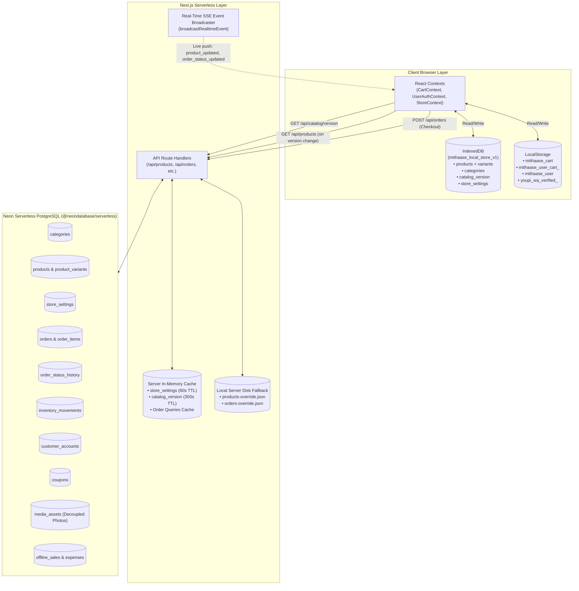

# Mithaasé Sweets — Data Storage, Persistence & Synchronization Architecture

**System:** Mithaasé Sweets E-Commerce Platform  
**Target Environments:** Client Browser (IndexedDB, LocalStorage, Cookies), Next.js Serverless Backend (Node In-Memory Cache, Disk Fallbacks, Real-time SSE), and Neon Serverless PostgreSQL  
**Document Version:** 1.0.0  
**Generated Date:** October 26, 2026  

---

## 1. Executive Architecture Summary

Mithaasé implements a **hybrid three-tier storage and synchronization architecture** designed to deliver **0ms instant loads**, offline cart resilience, real-time live order tracking, and minimal network egress costs on Neon PostgreSQL:

1. **Client Tier (Browser):**
   - **IndexedDB (`mithaase_local_store_v1`):** Fast binary/object caching of the entire product catalog, categories, portion variants, prices, and store settings.
   - **LocalStorage (`window.localStorage`):** Customer shopping cart state, per-user cart recovery, customer profile/address data, and temporary verification tokens.
   - **Browser Cookies:** Authentication session cookies for customer and administrator sessions.

2. **Server Tier (Next.js Node.js Serverless Engine):**
   - **Server In-Memory Cache (`lib/cache/server-cache.ts`):** High-speed TTL-based caching layer with tag invalidation (`products`, `settings`, `orders`) preventing repetitive SQL calls.
   - **Local Disk Fallbacks (`lib/data/*-override.json`):** Persistent disk fallbacks ensuring catalog and order continuity across serverless cold starts.
   - **Event Broadcaster (`lib/events/broadcast.ts`):** Node.js `EventEmitter` powering Server-Sent Events (SSE) to push live updates without client polling.

3. **Database Tier (Neon Serverless PostgreSQL):**
   - **Relational Tables (13 Tables):** Fully normalized PostgreSQL schema handling products, variants, orders, status history, coupons, customers, inventory movements, offline sales, and expenses.
   - **Decoupled Media Storage (`media_assets`):** Dedicated table offloading heavy Base64 upload images (UPI screenshots, delivery proof photos) to prevent database row bloat.

---

## 2. Architecture Diagram

---

## 3. Storage Layer Breakdown

### Tier 1: Client-Side Storage

| Storage Mechanism | Storage Key / Name | Schema / Content | Purpose & Invalidation Strategy |
| :--- | :--- | :--- | :--- |
| **IndexedDB** | Database: `mithaase_local_store_v1` Store: `catalog_cache` Key: `"catalog"` | `{ products: Product[], categories: Category[], version: string, cachedAt: number }` | **Zero-Network Catalog Render:** Render sweets menu in 0ms on startup. Validated against `/api/catalog/version`. If version matches, zero network requests to Neon. Updated whenever version shifts or SSE fires. |
| **IndexedDB** | Database: `mithaase_local_store_v1` Store: `catalog_cache` Key: `"settings"` | `{ store_name, store_status, default_delivery_fee, operating_hours, announcement_message, ... }` | Local store settings cache for fast rendering of announcements, delivery fees, and order cutoff alerts. |
| **LocalStorage** | `mithaase_cart` | Array of `OrderItem` objects: `[{ productId, variantId, quantity, price, productName, variantName, maxStock, image_url }]` | **Active Cart:** Retains user cart selections across browser refresh or navigation. Reconciles prices automatically against IndexedDB on load. |
| **LocalStorage** | `mithaase_user_cart_<email>` | Array of `OrderItem` objects for logged-in user email | **User Cart Persistence:** Preserves distinct shopping baskets across different customer logins. |
| **LocalStorage** | `mithaase_user` | `{ id, email, phone, pin, name, delivery_address, locality, landmark, delivery_instructions, ... }` | **Saved Customer Profile:** Instant customer address and contact population during checkout without database lookups. |
| **LocalStorage** | `youpi_wa_verified_<mobile>` | Verification timestamp / OTP state flag | **Temporary Checkout Token:** Remembers completed WhatsApp OTP verification during payment selection modal. Cleared upon order completion. |
| **Cookies** | Customer session cookie / Neon Auth token | Signed session token string | Used for HTTP request authorization on protected API routes and customer profile synchronization. |

---

### Tier 2: Server-Side In-Memory & Local Disk Storage

| Storage Mechanism | Path / Identifier | Content | Lifecycle & Purpose |
| :--- | :--- | :--- | :--- |
| **Server In-Memory Cache** (`lib/cache/server-cache.ts`) | Keys: `store_settings`, `catalog_version`, `media_<id>`, `orders_<status>_<email>_<search>` | Memory entries with TTL and tag invalidation (`tags: ['products', 'settings', 'orders', 'media']`) | Cuts repeated queries to Neon DB. Invalidated immediately when admin updates records. |
| **In-Memory Store** (`lib/data/store.ts`) | `global.__mithaase_store` | Active Node memory repository holding categories, products, orders, customers, coupons, settings. | Instant synchronous response cache preventing latency during serverless warm runs. |
| **Local Disk Fallback** (`lib/data/products-override.json`) | File on disk | Serialized `Product[]` JSON | Persists product catalog modifications across serverless cold starts even if external network/DB is temporarily unreachable. |
| **Local Disk Fallback** (`lib/data/orders-override.json`) | File on disk | Serialized `Order[]` JSON | Persists historical and active orders locally as an secondary fallback store. |

---

### Tier 3: Neon Serverless PostgreSQL Database

Configured in [`scripts/setup-db.mjs`](file:///d:/Code/VibeCode/Mithai/scripts/setup-db.mjs) and queried via the Neon HTTP driver (`neon(url)`) in [`lib/neon/db.ts`](file:///d:/Code/VibeCode/Mithai/lib/neon/db.ts):

| Table Name | Primary Key | Key Columns & Types | Description & Business Rules |
| :--- | :--- | :--- | :--- |
| **`categories`** | `id (UUID)` | `name`, `slug (UNIQUE)`, `description`, `display_order`, `is_active` | Catalog grouping (e.g. Barfi, Ladoo, Peda, Kaju Sweets, Namkeen). |
| **`products`** | `id (UUID)` | `name`, `slug (UNIQUE)`, `description`, `category_id (FK)`, `image_url`, `is_active`, `is_featured`, `badge`, `is_seasonal_special`, `special_start_date`, `special_end_date` | Main sweets catalog. Controls seasonal Diwali promotions and special items (e.g. Diwali Paneer Sabji). |
| **`product_variants`** | `id (UUID)` | `product_id (FK)`, `variant_name`, `unit`, `price`, `stock_quantity`, `reserved_quantity`, `low_stock_threshold`, `is_active` | Multi-portion sizing (250g, 500g, 1kg, 1L Handi) with individual variant stock and prices. |
| **`store_settings`** | `id (INT = 1)` | `store_name`, `store_status` (`open`/`paused`/`closed`), `accepts_orders`, `default_delivery_fee`, `minimum_order_value`, `service_areas (JSONB)`, `upi_id`, `upi_payee_name`, `announcement_message` | Global control room settings. Governs whether checkout is permitted and configures delivery rules. |
| **`orders`** | `id (VARCHAR)` | `order_number (UNIQUE)`, `customer_name`, `customer_email`, `customer_phone`, `delivery_address`, `locality`, `subtotal`, `delivery_charge`, `total_amount`, `payment_method`, `payment_status`, `order_status`, `upi_reference`, `cancellation_reason`, `refund_status`, `refund_amount`, `delivered_lat/lng` | Master customer orders with complete audit metadata. Heavy screenshot files are decoupled to `media_assets`. |
| **`order_items`** | `id (VARCHAR)` | `order_id (FK)`, `product_id (FK)`, `variant_id (FK)`, `product_name_snapshot`, `variant_name_snapshot`, `quantity`, `unit_price`, `line_total`, `image_url` | Frozen line item records created at time of checkout to guarantee historic pricing integrity. |
| **`order_status_history`** | `id (VARCHAR)` | `order_id (FK)`, `previous_status`, `new_status`, `changed_by`, `note`, `created_at` | Append-only audit log tracking every order stage change. |
| **`media_assets`** | `id (UUID)` | `mime_type`, `file_name`, `size_bytes`, `data_base64`, `created_at` | Dedicated internal object storage for UPI screenshots and delivery photos, served via `/api/media/[id]`. |
| **`inventory_movements`** | `id (UUID)` | `variant_id (FK)`, `movement_type`, `quantity_change`, `stock_after`, `reason`, `related_order_id`, `created_by` | Immutable ledger of all stock modifications (sales, additions, wastage, reservations, cancellations). |
| **`customer_accounts`** | `id (UUID)` | `email (UNIQUE)`, `phone`, `pin`, `name`, `delivery_address`, `locality`, `landmark`, `latitude`, `longitude`, `map_url` | Customer address and PIN directory for quick login and checkout auto-fill. |
| **`coupons`** | `id (UUID)` | `code (UNIQUE)`, `discount_type`, `discount_value`, `min_order_amount`, `max_discount_amount`, `is_active` | Discount codes (`FREEDEL`, `DIWALI50`, etc.) and redemption criteria. |
| **`offline_sales`** | `id (UUID)` | `sale_number (UNIQUE)`, `subtotal`, `discount_amount`, `total_amount`, `payment_method`, `customer_name`, `customer_phone` | In-person physical counter sales records. |
| **`expenses`** | `id (UUID)` | `title`, `category`, `amount`, `payment_method`, `expense_date`, `receipt_url` | Operational cost accounting (raw ingredients, ghee, packaging, fuel). |

---

## 4. How Everything Works: End-to-End Lifecycle

### A. Catalog Fetching & 0ms Initial Load
1. **Initial Mount:** When the customer visits the storefront, [`CategoryGrid.tsx`](file:///d:/Code/VibeCode/Mithai/components/storefront/CategoryGrid.tsx) and [`cart-context.tsx`](file:///d:/Code/VibeCode/Mithai/lib/context/cart-context.tsx) call `getCachedCatalog()` from IndexedDB.
2. **Instant Paint:** If products are found in IndexedDB, the customer sees the products and portion prices with 0ms latency.
3. **Background Version Check:** `cart-context` sends a tiny `GET /api/catalog/version` request.
4. **Cache Verification:**
   - If the server's version matches the cached version in IndexedDB, the browser does nothing. **Result: 0 database queries, 0 catalog transfer.**
   - If the version differs (or cache is empty), the client fetches `/api/products`, updates React state, reconciles cart prices, and calls `saveCatalogToCache(freshProducts, categories, newVersion)` to update IndexedDB.

### B. Order Placement Lifecycle
1. **Checkout Submission:** The customer submits the checkout form to `POST /api/orders`.
2. **Server-Side Validation:** The server verifies store status (`accepts_orders = true`), calculates actual variant prices from the database, enforces order weight limits (maximum 20kg), and checks stock availability.
3. **Inventory Deduction:** Variant stock is deducted, and an `inventory_movements` record is recorded.
4. **Media Decoupling:** If the customer uploaded a UPI payment screenshot, `persistMediaAsset()` writes the Base64 image to `media_assets` and replaces the order screenshot field with the link `/api/media/[mediaId]`.
5. **Database Transaction:** Rows are inserted into `orders`, `order_items`, `order_status_history`, and `customer_accounts` in Neon.
6. **Cache Invalidation & Real-Time Broadcast:** `serverCache.invalidateTag("orders")` purges order caches, and `broadcastRealtimeEvent("order_created", newOrder)` notifies the admin dashboard.
7. **Local Cart Clear:** Upon receiving the successful order response, the browser executes `clearCart()`, removing `mithaase_cart` from `localStorage`.

### C. Live Real-Time Order Tracking
1. Customer navigates to `/orders/[id]`.
2. [`LiveOrderTracker.tsx`](file:///d:/Code/VibeCode/Mithai/components/orders/LiveOrderTracker.tsx) establishes a Server-Sent Events (SSE) connection via [`useRealtime`](file:///d:/Code/VibeCode/Mithai/lib/hooks/useRealtime.ts).
3. When the admin or delivery rider updates the status (e.g. `preparing` &rarr; `out_for_delivery`), the server updates Neon DB and immediately broadcasts `order_status_updated`.
4. The customer's tracking screen transitions state automatically without repetitive polling intervals.

---

## 5. Updation and Deletion Mechanics

### Updation Operations

| Scenario | Neon Database | Server Cache & Disk | Client Browser (IndexedDB / LocalStorage) |
| :--- | :--- | :--- | :--- |
| **Product / Price Update** | `UPDATE products` and `UPDATE product_variants SET price = $1, stock_quantity = $2 ...` | `serverCache.invalidateTag("products")` Bumps `catalog_version = Date.now()` Saves to `products-override.json` | Real-time SSE pushes `product_updated`. Connected clients update React state and call `saveCatalogToCache(...)` in IndexedDB. Cart reconciles prices. |
| **Store Settings Update** | `UPDATE store_settings SET ... WHERE id = 1` | `serverCache.invalidateTag("settings")` | Next request fetches updated settings. Stored in IndexedDB `"settings"` store. |
| **Order Status Update** | `UPDATE orders SET order_status = $1` `INSERT INTO order_status_history` | `serverCache.invalidateTag("orders")` | SSE pushes `order_status_updated`. Live tracking UI transitions stage. |
| **Customer Profile Update** | `UPDATE customer_accounts SET name = $1, delivery_address = $2 ...` | Updated in `db.customers` array | `localStorage.setItem("mithaase_user", JSON.stringify(updatedUser))` |
| **Cart Items Update** | None (Client-only until checkout) | None | `localStorage.setItem("mithaase_cart", JSON.stringify(items))` |

---

### Deletion Operations

| Entity | Strategy | Database Action | Local / Cache Action |
| :--- | :--- | :--- | :--- |
| **Coupons** | **Hard Delete** | `DELETE FROM coupons WHERE id = $1;` | Splices coupon from in-memory `db.coupons` array. |
| **Products & Variants** | **Soft Delete / Cascade** | Recommended: toggles `is_active = FALSE`. If hard-deleted in SQL, `product_variants` cascade-delete via foreign keys (`ON DELETE CASCADE`), and past `order_items` retain their snapshots while setting `product_id = NULL` (`ON DELETE SET NULL`). | Removed from `products-override.json`, invalidated from server cache, and removed from IndexedDB on next version bump. |
| **Orders** | **Never Hard-Deleted** | Orders are **never** deleted with `DELETE FROM orders` to maintain legal tax and invoice records. To cancel an order: `order_status` is updated to `'cancelled'`, `cancellation_reason` is stored, and an entry is added to `order_status_history`. | Reserved sweets stock is credited back to `product_variants` and logged to `inventory_movements` as `order_cancellation`. |
| **Cart Items** | **Local Removal** | No database impact. | Individual item: `localStorage.setItem("mithaase_cart", filteredItems)`. Empty cart: `localStorage.removeItem("mithaase_cart")`. |
| **Customer Logout** | **Session Purge** | No database impact (account remains intact in `customer_accounts`). | `localStorage.removeItem("mithaase_user")` and session cookies cleared. |
| **IndexedDB Cache Reset** | **Browser Purge** | No database impact. | Can be invoked with `clearIndexedDbCache()`, clearing the `catalog_cache` object store. Repopulated automatically on subsequent storefront visits. |

---

## 6. Summary Comparison Matrix

| Dimension | IndexedDB | LocalStorage | Neon PostgreSQL |
| :--- | :--- | :--- | :--- |
| **Storage Location** | Client Browser Disk | Client Browser Key-Value | Remote Serverless Cloud |
| **Capacity** | Large (~50MB - 1GB+) | Small (~5MB limit) | Multi-gigabyte scalable database |
| **Data Types** | Structured JavaScript objects, arrays, blobs | UTF-16 Strings only | ACID Relational SQL rows & JSONB |
| **Persistence** | Permanent across sessions & reboots | Permanent across sessions & reboots | Master persistent cloud storage |
| **Network Cost** | 0 bytes | 0 bytes | Measured in Neon Compute and Egress |
| **Primary Role** | High-performance catalog and pricing cache | Shopping cart and user session persistence | Master ledger for catalog, orders, and money |
